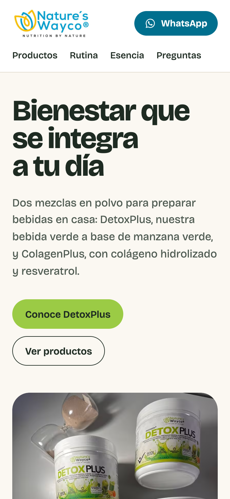
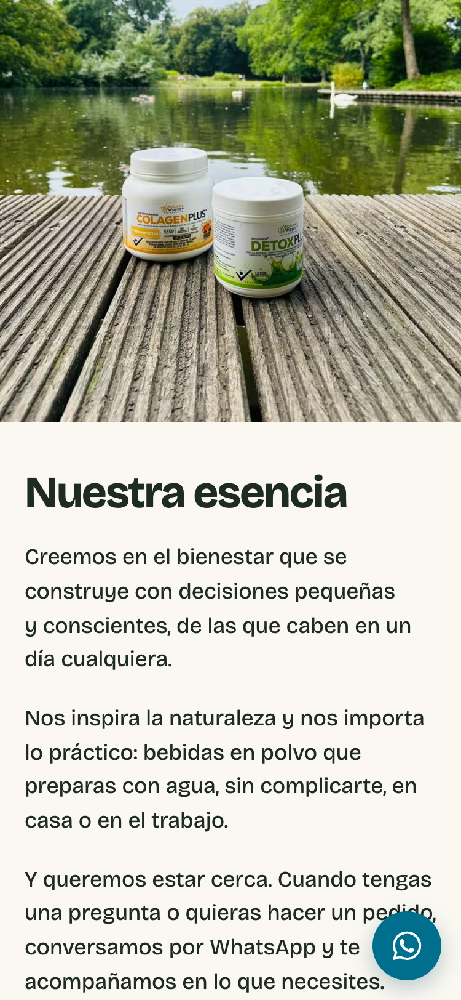
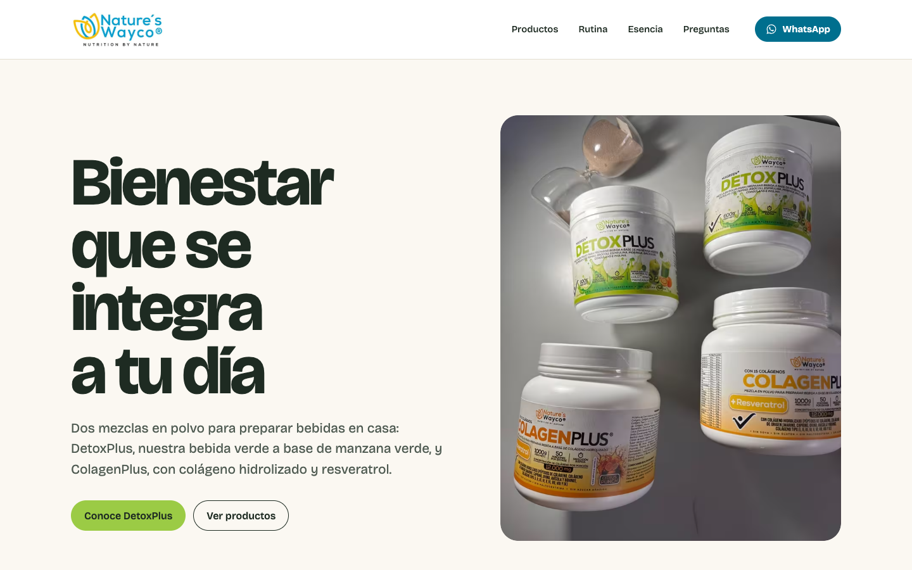

# Fase 1: base funcional y dirección visual inicial

Proyecto: landing de Nature’s Wayco · Fecha: 2026-10-20 · Estado: lista para revisión externa, **no publicada**.

## 1. Resumen del resultado

La landing es funcional en móvil, tableta y escritorio, con las siete secciones pedidas: encabezado, portada, productos, tu rutina, nuestra esencia, preguntas frecuentes, y cierre con pie de página.

- **Concepto aplicado:** «Bienestar que se integra a tu día». La base es marfil luminosa (`#FBF8F2`) con texto tinta verde oscuro (`#1E2B22`), y una sola familia tipográfica con personalidad (Bricolage Grotesque, servida desde el propio proyecto).
- **Elemento distintivo:** cada producto es un campo de color a todo el ancho, con una banda inferior tomada de su etiqueta: verde para DetoxPlus, ámbar para ColagenPlus. El cierre repite el recurso con el turquesa y el amarillo del logo. El resto de la página es sobrio: texto alineado a la izquierda, sin grillas de tarjetas, sin emojis y sin etiquetas en mayúsculas.
- **Prioridad comercial:** DetoxPlus aparece primero, con la frase «Nuestro producto más vendido», el CTA principal de la portada y la foto más grande en escritorio. ColagenPlus aparece después, con el mismo nivel de información.
- **Conversión:** cada botón «Pedir por WhatsApp» abre `wa.me` con el nombre y el precio del producto, codificados en la URL. Hay acceso a WhatsApp en el encabezado, el cierre, el pie y un botón flotante solo en móvil.
- **Movimiento:** una única secuencia de entrada en la portada. El texto sube y la foto se «llena» de abajo hacia arriba. Se desactiva con `prefers-reduced-motion`.
- **Verificación:** se ejecutaron build, lint, 8 pruebas unitarias, 53 verificaciones automáticas en Chrome a 320, 375, 768 y 1440 px, Lighthouse y una revisión visual de capturas. Todo pasa. Las pruebas pendientes están en la sección 6.

## 2. Stack utilizado y motivo

La carpeta no tenía aplicación: solo `README.md`, el ZIP y los materiales. Se usó React + TypeScript + Vite, como indicaba el brief para ese caso.

| Pieza | Versión | Motivo |
| --- | --- | --- |
| React + React DOM | 19.3 | Pedido en el brief. Componentes simples, sin router ni manejo de estado. |
| TypeScript | 6.0 | Tipos para catálogo, contacto y acción de compra. |
| Vite + @vitejs/plugin-react | 8.3 / 6.1 | Plantilla oficial `react-ts`; build estático en `dist/`. |
| @fontsource-variable/bricolage-grotesque | 5.3 | Tipografía servida desde el proyecto: no se pide nada a Google Fonts ni a otros servicios. |
| oxlint | 1.88 | Linter que trae la plantilla actual de Vite. |
| Vitest | 5.0 | Pruebas de precios, catálogo, URLs de WhatsApp y derivados. |
| playwright-core | 1.64 | Maneja el Chrome instalado (no descarga navegadores) para extraer fotogramas y verificar la UI. |

No se instaló Shopify, carrito, pagos, analítica ni ningún servicio externo.

## 3. Archivos creados o modificados

**Modificado**
- `README.md`: conserva sus dos líneas originales y agrega comandos y un mapa del proyecto.

**Configuración** (de la plantilla oficial de Vite, ajustada)
- `package.json`, `package-lock.json`, `index.html` (idioma `es-CO`, metadatos, íconos), `vite.config.ts`
- `tsconfig.json`, `tsconfig.app.json`, `tsconfig.node.json`, `tsconfig.test.json`
- `.gitignore`, `.oxlintrc.json`

**Datos y lógica**
- `src/data/catalog.ts`: productos, precios, presentaciones y datos del empaque.
- `src/data/contact.ts`: WhatsApp (provisional) e Instagram.
- `src/data/media.ts`: fotos, video, logo y textos alternativos.
- `src/commerce/order.ts`: acción de compra separada de la presentación; aquí se conectaría Shopify.
- `src/commerce/whatsapp.ts`: mensajes y URL `wa.me` codificada.
- `src/lib/format.ts`: formato de precios en COP.

**Interfaz**
- `src/main.tsx`, `src/App.tsx`, `src/index.css` (tokens, base, botones, foco)
- `src/components/`: `Header`, `Hero`, `Products`, `Routine`, `Essence`, `Faq`, `Closing`, `Footer`, `FloatingWhatsApp` (cada uno con su `.css`), además de `Picture.tsx`, `Logo.tsx`, `icons.tsx` y `navigation.ts`.

**Medios** (derivados; los originales no se tocaron)
- `public/media/`: 34 imágenes (AVIF, WebP y JPEG en varios anchos) y `video/detoxplus-preparacion.mp4`.
- `public/favicon-32.png`, `public/apple-touch-icon.png`, `public/robots.txt`

**Scripts y pruebas**
- `scripts/build-media.mjs`: regenera los derivados (`npm run media`).
- `scripts/verify-ui.mjs`: verificación en Chrome y capturas (`npm run verify`).
- `tests/catalog.test.ts`: pruebas unitarias (`npm test`).

**Documentación**
- `docs/reports/FASE-01.md` (este reporte), `docs/reports/verify-fase-01.txt` (salida completa de la verificación) y `docs/reports/capturas/fase-01/` (13 capturas).
- `docs/shopify.md`: dónde y cómo se conectaría Shopify.
- `docs/pendientes.md`: datos por confirmar y verificaciones regulatorias, fuera del texto comercial.

Nada quedó en commit: todos los archivos están sin confirmar en git para que puedan revisarse.

## 4. Materiales usados y ubicación

**Origen.** El ZIP `visual-pieces.zip` se conserva intacto en la raíz. Al empezar, `./visual-pieces/` ya estaba extraído. Lo comparé archivo por archivo (SHA-256) con una extracción nueva del ZIP en una carpeta temporal: los 8 archivos son idénticos, así que no se volvió a extraer. La carpeta `__MACOSX` del ZIP se ignoró y no existe en el proyecto. La copia en `/Users/juanpablocardozo/Documents/ChatGPT/Natures Waysco/visual-pieces/` también existe y es idéntica.

**Videos.** Antes de incorporarlos, verifiqué en Chrome que ambos reproducen: H.264/AAC, 576 × 1024 px, `moov` al inicio, 10,1 s y 6,9 s.

| Original | Derivado en `public/media/` | Uso en la página | Tratamiento |
| --- | --- | --- | --- |
| `detox_y_colageno.jpeg` (1200×1600) | `hero-productos-{480,800,1200}` | Portada | Recorte 4:5 (se quitan 100 px inferiores). Muestra 2 DetoxPlus y 2 ColagenPlus. |
| `video_detox.mp4`, fotograma a 9,0 s | `detoxplus-vaso-576` | Producto DetoxPlus | Fotograma real (vaso con bebida verde + envase), recorte 4:5. Es el único material que muestra DetoxPlus solo. |
| `colageno_img.jpeg` (1200×1600) | `colagenplus-vaso-{480,800,1200}` | Producto ColagenPlus | Recorte 4:5 sin cortar el envase. |
| `video_detox.mp4`, fotograma a 3,4 s | `rutina-poster-576` | Póster del video en «Tu rutina» | Fotograma completo. |
| `video_detox.mp4` | `video/detoxplus-preparacion.mp4` | Video en «Tu rutina» | Copia sin recodificar (no hay ffmpeg; el archivo ya es apto para web). `preload="none"`: no se descarga hasta que se reproduce. |
| `detox_colageno_nature.jpeg` (960×1280) | `esencia-lago-{480,960}` | Nuestra esencia | Completo; en pantalla se encuadra 4:5 centrado en los envases. |
| `logo.jpeg` (1080×1080, fondo blanco) | `logo-{300,600}` (WebP + JPEG) | Encabezado y pie | Recorte del logotipo completo con margen blanco. Va siempre sobre superficie blanca (`#FFFFFF`, igual al fondo medido del original). No se quitó el fondo ni se redibujó. |
| `logo.jpeg` (símbolo) | `favicon-32.png`, `apple-touch-icon.png` | Pestaña del navegador | Recorte del símbolo sobre blanco. |
| `etiqueta_detox.jpeg`, `etiqueta_colageno.jpeg` | — | No se muestran | Solo como referencia de textos: porciones, tamaño de porción y preparación. |
| `video_detox_colageno.mp4` | — | No se usa | Verificado. Repite la escena de `detox_y_colageno.jpeg` (mismos 4 envases y reloj de arena); se omite para no duplicar ni sumar peso. |

**Textos tomados del empaque** (solo lo legible en las fotos):
- **DetoxPlus:** mezcla a base de manzana verde, con pepino, brócoli, espirulina, moringa, *Bacillus coagulans* e inulina. Sabor idéntico al natural a lulo, kiwi y manzana. 600 g, 30 porciones.
- **ColagenPlus:** colágeno hidrolizado de origen marino, caprino, ovino, avícola y bovino, más resveratrol. Sabor idéntico al natural a Citrus Punch. 1.000 g, 50 porciones.
- **Ambos:** «sin soya, sin gluten, sin maltodextrina y sin azúcar añadida», presentado como «El empaque indica». La tabla nutricional de ambos indica que una porción es «1 cucharada dosificadora (20 g) en 200 mL de agua».

No se transcribieron las listas de ingredientes laterales ni las advertencias, que están cortadas en las fotos.

## 5. Instrucciones para ejecutar y revisar

```bash
cd app_natures_waysco
npm install
npm run dev          # http://localhost:5173
```

**Revisión de producción:**

```bash
npm run build && npm run preview   # http://localhost:4173
npm test                            # 8 pruebas
npm run lint
npm run verify                      # 53 verificaciones + capturas en docs/reports/capturas/fase-01/
```

`npm run verify` levanta `vite preview` por su cuenta y usa el Chrome de macOS. Para otra ubicación: `CHROME_PATH=/ruta/a/chrome npm run verify`.

**Qué mirar:**
- Portada: titular, dos CTA, foto de los cuatro envases.
- «Conoce DetoxPlus» lleva a `#detoxplus`; «Ver productos», a `#productos`.
- En cada producto, el botón «Pedir por WhatsApp» (pasar el cursor para ver la URL sin abrirla).
- En «Tu rutina», el video solo carga al darle reproducir.
- En móvil, el botón flotante aparece y desaparece al desplazarse.
- Con «Reducir movimiento» activo en el sistema, no hay animación.
- Cambiar datos de contacto: `src/data/contact.ts`. Cambiar precios: `src/data/catalog.ts`.

## 6. Pruebas ejecutadas y resultados

### Ejecutadas

| Prueba | Resultado |
| --- | --- |
| `npm run build` (incluye `tsc -b` sobre la app, `vite.config.ts` y las pruebas; los scripts `.mjs` no se tipan) | Correcto. JS 236,5 kB (74,5 kB gzip), CSS 13,3 kB (3,8 kB gzip). |
| `npm run lint` (oxlint) | Sin advertencias. Se corrigió una: `new Date()` durante el render del pie. |
| `npm test` (Vitest) | 8/8: precios `$70.000 COP` / `$130.000 COP`, orden DetoxPlus → ColagenPlus, presentaciones, foto correcta por producto, número y mensaje de WhatsApp, codificación (`¿`, `$`, `&`, tildes), y existencia de los 3 formatos para cada ancho. |
| `npm run verify` (Chrome sin interfaz) | **53/53.** Detalle completo en `docs/reports/verify-fase-01.txt`. |
| Lighthouse 12.8 (local, móvil simulado) | Rendimiento 98 · Accesibilidad 100 · Buenas prácticas 100 · SEO 100. FCP 1,2 s, LCP 2,4 s, CLS 0, TBT 0 ms, 269 KiB transferidos. |
| Lighthouse 12.8 (local, escritorio) | 100 · 100 · 100 · 100. FCP 0,3 s, LCP 0,5 s, CLS 0, 256 KiB transferidos. |
| Contraste (cálculo WCAG) | Texto ≥ 5,9:1 en todas las superficies; botones ≥ 5,7:1; anillo de foco ≥ 4,8:1. El turquesa del logo (2,7:1) solo se usa como decoración. |
| Búsqueda de términos prohibidos en el texto | Sin «desintoxicar», curación, peso, rejuvenecer, garantías, vegano/vegetal, reseñas, descuentos, certificaciones, INVIMA, dosis ni frecuencias. |
| Revisión visual de capturas a 320, 375, 768 y 1440 px | Se encontraron y corrigieron los problemas listados abajo. |

**Qué cubren las 53 verificaciones de `verify`:**
- **Desbordamiento:** sin desbordamiento horizontal en 320, 375, 768 y 1440 px. `scrollWidth` es igual al ancho, y ningún elemento sale del viewport.
- **Sin solicitudes ni errores:** se bloquean todas las solicitudes externas y se confirma que no hubo ninguna. Sin errores de consola.
- **Imágenes:** las 6 tienen `alt`, `width` y `height`, y cargan. El navegador recibe AVIF o WebP.
- **Productos:** nombre, precio e imagen corresponden en `#detoxplus` y `#colagenplus`. DetoxPlus aparece antes que ColagenPlus. Hay un solo `h1` y la jerarquía de títulos es correcta.
- **WhatsApp:** los 6 enlaces apuntan a `wa.me/573124475525`. Los de producto incluyen nombre y precio. Todos tienen `target="_blank"` y `rel="noopener noreferrer"` y la codificación de la URL es exacta. **No se abrió WhatsApp ni se envió ningún mensaje.** Ejemplo:
  `https://wa.me/573124475525?text=Hola%2C%20Nature%E2%80%99s%20Wayco.%20Quiero%20pedir%20DetoxPlus%20(%2470.000%20COP).%20%C2%BFMe%20confirman%20disponibilidad%20y%20env%C3%ADo%3F`
- **Anclas:** las 12 anclas internas apuntan a secciones existentes. Enter en «Preguntas» lleva a la sección (queda a 32 px del borde por `scroll-margin`).
- **Teclado:**
  - El primer Tab enfoca «Saltar al contenido».
  - Las 28 paradas de Tab tienen foco visible (contorno ≥ 2 px) y quedan en pantalla.
  - El orden es lógico: logo → navegación → WhatsApp → CTA → productos → video → preguntas → cierre → pie.
  - Las preguntas frecuentes se abren con Enter.
  - El botón flotante oculto no recibe foco.
- **Video:** no se descarga al cargar la página (en ningún tamaño). Al pedirlo, se descarga y reproduce: avanzó 1,46 s en 1,5 s.
- **Botón flotante (móvil):**
  - Oculto con el encabezado visible y sobre botones de pedido, video, cierre y pie.
  - Visible en zonas de lectura.
  - No se superpone a enlaces ni controles en los puntos revisados.
  - En escritorio no se muestra.
- **Movimiento reducido:** con `prefers-reduced-motion: reduce` se desactivan las animaciones y el desplazamiento suave.

**Problemas encontrados en la revisión visual y corregidos:**
1. La foto del lago no llegaba a los bordes en móvil (la regla global `max-width: 100%` anulaba el sangrado).
2. En escritorio, las ideas de «Tu rutina» en tres columnas quedaban de unos 20 caracteres por línea; ahora van en una sola lista.
3. Las preguntas frecuentes estaban centradas mientras el resto de la página se alinea a la izquierda.
4. El cierre en escritorio dejaba media pantalla vacía; ahora se divide en dos columnas.
5. A 320 px el enlace «Preguntas» pasaba a una segunda línea.
6. Faltaba un foco visible propio en el video (sus controles nativos están en el shadow DOM).
7. Lighthouse marcó `robots.txt` como inválido (el servidor devolvía el HTML) y el póster en JPEG; se agregó `robots.txt` y el póster pasó a WebP. SEO pasó de 92 a 100.
8. Una medición mostró un pequeño desplazamiento de diseño (CLS 0,033) al cambiar de la fuente del sistema a Bricolage. Se precarga la fuente latina desde `index.html` y el CLS volvió a 0.

### Pendientes (no realizadas)

- **Dispositivos reales:** iPhone con Safari y Android con Chrome, incluidas áreas seguras y barra inferior de iOS. Solo se emuló con Chrome.
- **Otros navegadores:** Safari y Firefox de escritorio.
- **Lector de pantalla:** VoiceOver o NVDA; la estructura se revisó, pero no se escuchó.
- **WhatsApp en un teléfono:** abrir el enlace con la app instalada para confirmar que el mensaje llega precargado. No se hizo para no enviar mensajes.
- **Audio del video:** no se revisó su contenido.
- **Rendimiento en hosting real:** las cifras de Lighthouse son de un servidor local.
- **Modo de alto contraste** (`forced-colors`) y zoom de texto al 200 %.

## 7. Capturas

Generadas con `npm run verify` en `docs/reports/capturas/fase-01/`. Las de página completa están a densidad 1×: a 2× superan el límite de captura de Chrome (16.384 px) y la imagen se repite al final. Ese defecto apareció en la primera ronda; era de la herramienta, no de la página, y se comprobó con una captura del final de la página.

| Vista | Archivo |
| --- | --- |
| Móvil 375, portada |  |
| Móvil 375, página completa | [movil-375-pagina.png](capturas/fase-01/movil-375-pagina.png) |
| Móvil 375, botón flotante visible |  |
| Móvil 375, final de página | [movil-375-final.png](capturas/fase-01/movil-375-final.png) |
| Móvil 320 | [portada](capturas/fase-01/movil-320-portada.png) · [página](capturas/fase-01/movil-320-pagina.png) · [final](capturas/fase-01/movil-320-final.png) |
| Tableta 768 | [portada](capturas/fase-01/tableta-768-portada.png) · [página](capturas/fase-01/tableta-768-pagina.png) · [final](capturas/fase-01/tableta-768-final.png) |
| Escritorio 1440, portada |  |
| Escritorio 1440, página completa | [escritorio-1440-pagina.png](capturas/fase-01/escritorio-1440-pagina.png) |
| Escritorio 1440, final | [escritorio-1440-final.png](capturas/fase-01/escritorio-1440-final.png) |

## 8. Supuestos y datos pendientes

El detalle está en `docs/pendientes.md`. Resumen:

**Por confirmar con el propietario antes de publicar**
- **WhatsApp:** `+57 312 447 5525` es provisional, observado en Instagram. La etiqueta de ColagenPlus muestra un número parcialmente visible que termina igual, pero eso no reemplaza la confirmación. Se cambia en `src/data/contact.ts`.
- **Dominio:** no existe. Por eso no hay `canonical`, `og:url`, `og:image` ni `sitemap.xml`.
- **Frase de DetoxPlus:** «Nuestro producto más vendido» se basa en el brief.
- **Envíos y pagos:** ciudades, costos, tiempos, si el precio incluye envío y los medios de pago. Nada de esto se publica; la página remite a WhatsApp.
- **Compromisos del texto:** el texto de las preguntas frecuentes compromete al negocio a «confirmar disponibilidad y condiciones de envío antes de cerrar el pedido». Conviene que el propietario lo valide.

**Supuestos**
- Los materiales del ZIP son del negocio y pueden usarse en la web.
- El video de DetoxPlus muestra una preparación propia de la marca. Su pie de foto («Un DetoxPlus servido en casa») no recomienda hielo, limón ni cantidades.
- **Registro INVIMA:** la etiqueta de DetoxPlus muestra «NSA-004320-2018». No se usa en la página porque no se verificó su vigencia.
- **Preparación de etiqueta:** «1 cucharada dosificadora (20 g) en 200 mL de agua» se presenta como la preparación de una porción según el empaque. Va separada de las ideas de rutina, con la aclaración de que no es una recomendación de cuánto ni cada cuánto consumir.

## 9. Limitaciones y errores conocidos

- **Superposición del botón flotante:** en móvil puede quedar por un momento sobre el borde derecho de texto corrido mientras se desplaza la página (se ve en la captura del botón flotante). No tapa controles: se oculta cerca de los botones de pedido, el video, el cierre y el pie, y al final de la página no cubre nada. Si se prefiere cero superposición, la alternativa es un encabezado fijo en móvil con el botón de WhatsApp, en lugar del botón flotante.
- **Foto de DetoxPlus:** es un fotograma de video de 576 × 720 px. En pantallas grandes de alta densidad se ve algo suave. Hace falta una fotografía de producto.
- **Renderizado en el cliente:** el contenido se genera con JavaScript (SPA). Sin JS no se ve, y algunos rastreadores lo leerán peor. Para publicar conviene prerenderizar el HTML en el build.
- **Videos sin recodificar:** el de DetoxPlus pesa 1,7 MB y conserva su pista de audio; solo se descarga al reproducirlo. No había ffmpeg para comprimirlo o quitarle el audio.
- **Logo:** es un JPEG con fondo blanco, por eso solo se usa sobre blanco. El lema «Nutrition by nature» queda muy pequeño a 128–148 px de ancho.
- **Escritorio:** el encabezado no es fijo, y el botón flotante es solo para móvil (< 960 px). En escritorio el acceso a WhatsApp está en el encabezado, en cada producto y en el cierre.
- **Titular en escritorio:** queda en cuatro líneas a 1440 px. Es una decisión de composición, revisable en la fase de diseño.
- **Scripts:** `npm run media` y `npm run verify` dependen de Chrome instalado, y `media` también de ImageMagick 7 con AVIF/WebP.
- **Derivados sin uso:** el póster del video se genera en AVIF y JPEG además de WebP, pero solo se usa el WebP.
- **Errores abiertos:** no hay errores conocidos sin resolver en las verificaciones ejecutadas.

## 10. Próximo paso recomendado

1. Que el propietario confirme el número de WhatsApp, la frase «más vendido», el texto sobre envíos y el uso de los materiales. Si es posible, que entregue una foto individual de DetoxPlus y el logo en SVG o PNG transparente.
2. Probar en un teléfono real con WhatsApp instalado: abrir un botón de producto, revisar el mensaje precargado y **no enviarlo**.
3. Con eso, pasar a la fase de refinamiento visual con Claude Design. Puntos a llevar:
   - el titular de escritorio;
   - la decisión entre botón flotante o encabezado fijo en móvil;
   - el ritmo entre «Tu rutina» y «Nuestra esencia»;
   - el tamaño del lema del logo.
4. Antes de publicar, en una fase aparte: definir dominio y hosting, prerenderizar el HTML, completar `canonical` y Open Graph con URL absolutas, y decidir si se recodifica el video.
