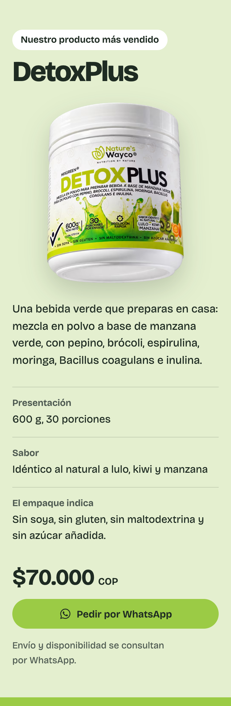
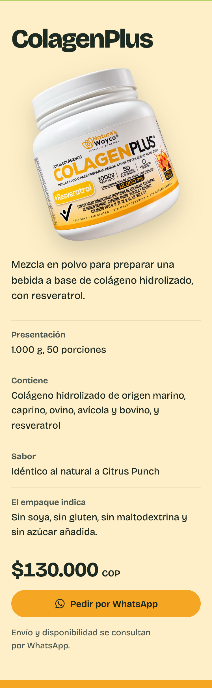
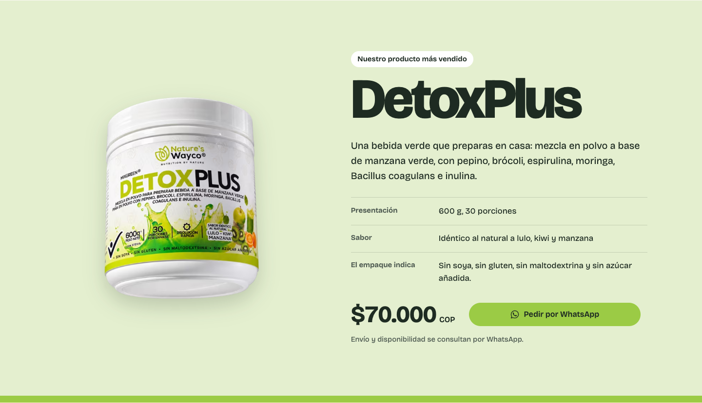
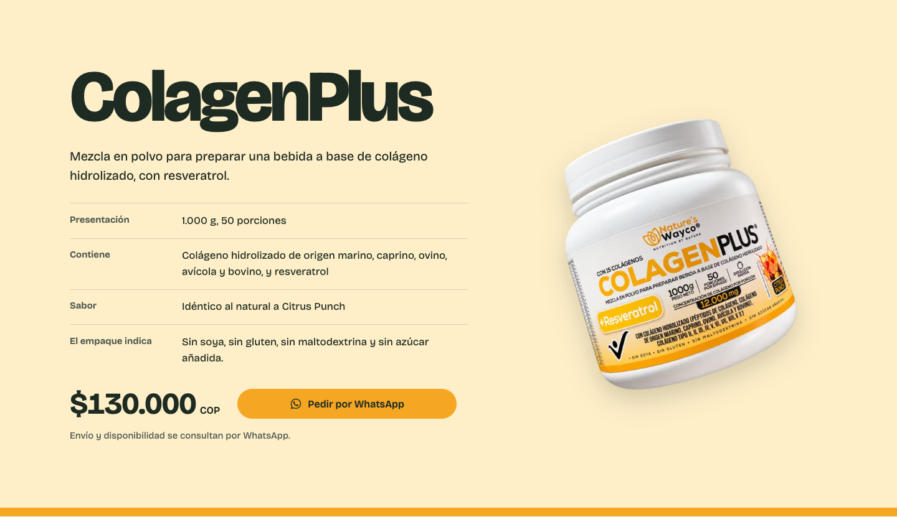

# Fase 2 · Ajuste: recortes PNG en las fichas de producto

Proyecto: landing de Nature’s Wayco · Fecha: 2026-10-21 · Estado: **ajuste completo, no publicado**.

> **Aviso antes de publicar.** Los dos PNG entregados no son fotografías con el fondo eliminado. Su propio
> `generation-metadata.json` indica que se hicieron con un generador de imágenes («built-in image_gen»),
> con la nota *«label microtext and edge artefacts require review before publishing»*. Al compararlos con
> las fotos originales, la etiqueta **cambia información del producto**:
> - **DetoxPlus:** agrega «piña en polvo» y «con stevia», que no aparecen en la etiqueta fotografiada.
> - **ColagenPlus:** lista mal los tipos de colágeno («II, II, III… X XY» en vez de «I… VIII y IX») y escribe «maltodektrina».
>
> Los implementé como se pidió, porque son los archivos definitivos y la página no está publicada. Pero
> **no deberían publicarse** hasta confirmar el texto con el envase físico o reemplazarlos. Detalle y
> evidencia en la sección 4.

## 1. Cambios

**Imágenes de las fichas.** DetoxPlus y ColagenPlus muestran ahora su recorte frontal con transparencia en lugar de la fotografía anterior.

**Imagen sin marco.** Se quitaron el recorte 4:5 (`object-fit: cover`) y las esquinas redondeadas. No hay fondo, borde ni marco: alrededor del tarro se ve el campo de color de cada sección.

**Producto completo.** La imagen usa `object-fit: contain` y conserva su proporción. Lo único que se recortó es el margen transparente del lienzo: los píxeles con opacidad < 1 %, invisibles. No se retocaron etiquetas ni se regeneró nada.

**Tamaños equilibrados.** Los dos tarros comparten un mismo alto:
- móvil: `clamp(16rem, 78vw, 22rem)`;
- escritorio: `26rem`.

ColagenPlus se muestra un 5 % más alto porque su tarro inclinado deja esquinas vacías en el recorte. Así el área visible de ambos envases queda pareja (relación medida: 1,05).

**Sombra suave.** `filter: drop-shadow(0 1.1rem 1.25rem rgb(30 43 34 / 0.2))`.

**Escritorio.** El tarro se centra verticalmente junto al texto. La estructura de columnas no cambió.

**Formatos.** Derivados AVIF y WebP con transparencia, y PNG como respaldo, en tres anchos. Ver la sección 2.

**Sin cambios:**
- precios, textos, botones, enlaces de WhatsApp y estructura;
- las fotografías de portada, rutina y esencia (hashes de sus derivados idénticos antes y después);
- no hay giro, reverso, 3D ni efectos al pasar el cursor.

## 2. Archivos

**Originales copiados** (byte a byte; los de `Documents/ChatGPT/…/product-cutouts/` siguen intactos):

| Archivo en el proyecto | Origen | Tamaño |
| --- | --- | --- |
| `visual-pieces/recortes/detoxplus-frente-recorte-v1.png` | `detoxplus-front-v1.png` | 1254 × 1254, 1,46 MB |
| `visual-pieces/recortes/colagenplus-frente-recorte-v1.png` | `colagenplus-front-v1.png` | 1254 × 1254, 1,54 MB |
| `visual-pieces/recortes/recortes-generacion-metadata.json` | `generation-metadata.json` | Registro de cómo se generaron |

En `visual-pieces/` también aparecieron `detox_png.png` y `colagen_png.png`, que no creé yo. Son idénticos (SHA-256) a los recortes usados, así que no hay duda sobre la versión. No los toqué.

**Derivados** (`public/media/`, generados con `npm run media -- --solo-recortes`):

| Ancho | DetoxPlus AVIF / WebP / PNG | ColagenPlus AVIF / WebP / PNG |
| --- | --- | --- |
| Pequeño | 440 × 576: 32 / 48 / 358 KB | 500 × 582: 35 / 53 / 359 KB |
| Medio | 640 × 838: 50 / 81 / 696 KB | 740 × 861: 56 / 96 / 743 KB |
| Grande | 860 × 1125: 70 / 118 / 1179 KB | 980 × 1140: 76 / 140 / 1256 KB |

**Carga.** Un navegador actual descarga AVIF:
- escritorio 1×: 32 + 35 KB;
- móvil 2×: 50 + 56 KB.

Frente a los PNG originales (1,46 + 1,54 MB) es una reducción de alrededor del 95 %. El PNG solo lo pediría un navegador sin AVIF ni WebP. El ancho medio se añadió después de medir: sin él, el móvil descargaba la versión de 860/980 px.

**Código y scripts modificados**

| Archivo | Cambio |
| --- | --- |
| `src/data/media.ts` | Nuevos `detoxCutout` y `colagenCutout`, y campo opcional `fallback: 'png'`. Las fotos anteriores siguen definidas, sin uso, para poder volver a ellas. |
| `src/data/catalog.ts` | Cada producto usa su recorte. |
| `src/components/Picture.tsx` | El respaldo puede ser PNG en lugar de JPEG. |
| `src/components/Products.css` | Reglas de la imagen de ficha (ver sección 1). |
| `src/components/Products.tsx` | Solo el atributo `sizes`: `(min-width: 960px) 25rem, 18rem`. |
| `scripts/build-media.mjs` | Paso `buildCutouts()` y opción `--solo-recortes`, para no regenerar los demás derivados. |
| `scripts/verify-ui.mjs` | Revisiones de los recortes, capturas por ficha y carpeta configurable (`CAPTURAS=`). Así las capturas de la Fase 1 no se sobrescriben. |
| `tests/catalog.test.ts` | Las fichas usan recortes con respaldo PNG, y existen todos los derivados declarados. |
| `docs/pendientes.md`, `README.md` | Pendiente de revisión de etiquetas y ubicación de los recortes. |

**Documentación de este ajuste:**
- `docs/reports/FASE-02-PNG.md` (este reporte);
- `docs/reports/verify-fase-02-png.txt` (salida completa);
- `docs/reports/capturas/fase-02-png/` (22 imágenes).

## 3. Verificaciones

| Prueba | Resultado |
| --- | --- |
| `npm run build` | Correcto. JS 236,5 kB (74,5 kB gzip), CSS 13,5 kB (3,9 kB gzip). |
| `npm run lint` | Sin advertencias (código de salida 0). |
| `npm test` | 9/9, con una prueba nueva para los recortes y su respaldo PNG. |
| `CAPTURAS=fase-02-png npm run verify` | **65/65.** Detalle en `docs/reports/verify-fase-02-png.txt`. |
| Lighthouse 12.8, móvil (local, 3 corridas) | Rendimiento 96 · Accesibilidad 100 · Buenas prácticas 100 · SEO 100. LCP 2,7 s, CLS 0, 344 KiB. |

**Qué revisa `verify` en las fichas**, a 320, 375, 768 y 1440 px:
- **Transparencia real** de la imagen servida: alfa 0 en la esquina y opaco en el centro, leído con un canvas en el navegador.
- **Ajuste:** `object-fit: contain` con la proporción conservada.
- **Sin marco:** sin esquinas redondeadas, sin borde, sin fondo en la imagen ni en `<picture>`, y con la sombra aplicada.
- **Sin recortes:** ningún contenedor recorta el tarro y el tarro no se sale de la ventana.
- **Equilibrio:** el alto de ColagenPlus dividido por el de DetoxPlus da 1,05 en todos los anchos.

Todo correcto. También pasan las revisiones que ya existían:
- sin desbordamiento horizontal;
- imágenes con `alt`, dimensiones y carga;
- nombre, precio e imagen correctos en cada ficha;
- enlaces de WhatsApp: apuntan a `wa.me/573124475525`. El de DetoxPlus lleva «Quiero pedir DetoxPlus ($70.000 COP)…» y el de ColagenPlus «Quiero pedir ColagenPlus ($130.000 COP)…». Están codificados y se revisaron sin abrir WhatsApp ni enviar nada;
- teclado, video bajo demanda, botón flotante y movimiento reducido.

**Tamaños medidos del tarro:**

| Ancho | DetoxPlus | ColagenPlus |
| --- | --- | --- |
| 375 px | 223 × 293 px | 264 × 307 px |
| 1440 px | 318 × 416 px | 376 × 437 px |

**Transparencia en origen.** Los PNG son RGBA de verdad (esquinas `srgba(0,0,0,0)`). Cada uno tiene una sola pieza opaca, sin manchas sueltas, y unos 10.000 píxeles de borde suavizado. Los bordes no muestran halo visible sobre los fondos claros de las secciones.

**Regresión de carga.** Antes del ajuste, Lighthouse móvil daba LCP 2,4 s y 269 KiB (rendimiento 98). Ahora da 2,7 s y 344 KiB (96).

Esto se midió por separado:
- El elemento LCP sigue siendo el logo del encabezado; lo que crece es su «retraso de renderizado».
- Quitar la sombra no lo corrige: 2,6–2,7 s.
- Servir solo WebP lo empeora: 2,7–2,9 s y 415 KiB.
- La configuración final (AVIF + anchos intermedios) es la mejor de las probadas.

## 4. Pendientes

1. **Bloqueante para publicar: revisar las etiquetas de los recortes.** Evidencia lado a lado en `capturas/fase-02-png/discrepancias-etiquetas.png`:

   | Envase | Foto original | Recorte v1 |
   | --- | --- | --- |
   | DetoxPlus | «…manzana verde **en polvo** con pepino, brócoli…» | «…manzana verde **piña en polvo** con pepino, brocoli…» |
   | DetoxPlus | — | «**· Con stevia ·**» bajo «600g» |
   | DetoxPlus | Ícono de cronómetro | Ícono de engranaje; hoja añadida sobre «30» |
   | ColagenPlus | «Colágeno tipo **(I, II, III, IV, V, VI, VII, VIII y IX)**» | «Colágeno tipo **II, II, III, … VIII, X XY**» |
   | ColagenPlus | «Sin maltodextrina» | «Sin malto**dek**trina» |

   Opciones:
   - Que el propietario confirme con el envase vigente que el texto es correcto. Piña y stevia son información de ingredientes.
   - O usar fotografía real con el fondo eliminado, sin regenerar la etiqueta.

   Volver a las fotos anteriores es cambiar dos líneas en `src/data/catalog.ts` (`detoxPhoto` y `colagenPhoto`).
2. **LCP móvil de 2,7 s.** Pasa el umbral de 2,5 s de Lighthouse. Hay una mejora probable que queda fuera del alcance de este ajuste: dar prioridad al logo del encabezado, que es el elemento LCP, con `fetchpriority="high"` o precarga. Medirla en la próxima fase.
3. **Derivados sin uso.** `detoxplus-vaso-576.*` y `colagenplus-vaso-*` quedan en `public/media/`, sin mostrarse, mientras se decide el punto 1. Los PNG de respaldo (≈ 4,5 MB en total) se publican pero un navegador actual no los descarga.
4. **Pruebas no realizadas:** iPhone y Android reales, Safari y Firefox, y modo `forced-colors`.
5. **Siguen vigentes los pendientes anteriores:** número de WhatsApp provisional, dominio, registro INVIMA y la decisión sobre las portadas de `FASE-02-portadas.md`.

## 5. Capturas

Capturas de cada ficha a densidad 2× en móvil y 1× en escritorio, en `docs/reports/capturas/fase-02-png/`. El botón flotante se ocultó solo en estas capturas: es fijo a la ventana y, en una captura de elemento más alta que la ventana, se pintaría sobre la ficha. Su comportamiento real se revisa aparte.

| | DetoxPlus | ColagenPlus |
| --- | --- | --- |
| Móvil 375 |  |  |
| Escritorio 1440 |  |  |

**Otros tamaños:**
- [320 DetoxPlus](capturas/fase-02-png/movil-320-ficha-detoxplus.png) · [320 ColagenPlus](capturas/fase-02-png/movil-320-ficha-colagenplus.png)
- [768 DetoxPlus](capturas/fase-02-png/tableta-768-ficha-detoxplus.png) · [768 ColagenPlus](capturas/fase-02-png/tableta-768-ficha-colagenplus.png)
- Páginas completas: [móvil 375](capturas/fase-02-png/movil-375-pagina.png) · [escritorio 1440](capturas/fase-02-png/escritorio-1440-pagina.png)
- Evidencia de etiquetas: [discrepancias-etiquetas.png](capturas/fase-02-png/discrepancias-etiquetas.png)
