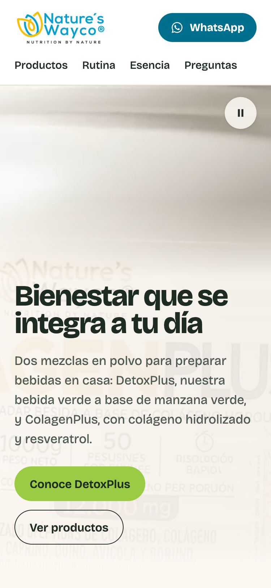
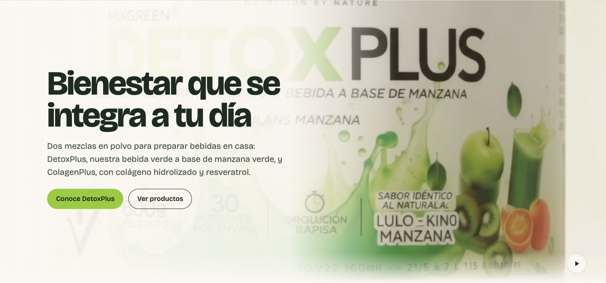
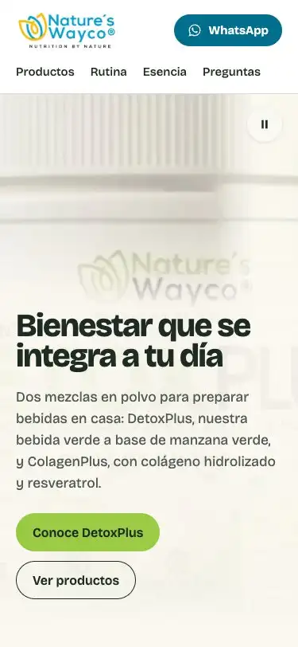

# Fase 3 · Video de fondo en la portada

Proyecto: landing de Nature’s Wayco · Fecha: 2026-10-21 · Estado: **fase completa, no publicada**.

> **Aviso antes de publicar.** El texto de las etiquetas que aparece en el video **no corresponde al
> empaque real** y contiene palabras que no existen:
> - **ColagenPlus:** «Metcla di polvo para prepadar besida a base de coláceno horoucado», «Pesuines for envnee», «Citflb Punch».
> - **DetoxPlus:** «Hezela en polvo…», «600g mele noto», «Poretones», «Drolución rapisa», «Lulo - kino manzana».
>
> Tiene las marcas típicas de un video generado. El archivo llegó sin metadatos que lo confirmen. En
> escritorio varias de esas palabras se leen con claridad. Lo implementé como se pidió porque la página
> no está publicada, pero **no debería publicarse** sin aprobación del propietario o sin reemplazarlo por
> video real. Evidencia: `capturas/fase-03/video-etiquetas.png`.

## 1. Cambios y archivos

### Cambios

**Fondo de la portada.** La foto se reemplazó por el video, que ocupa solo la sección Hero, a todo el ancho y sin marco ni esquinas redondeadas. Las capas, de abajo hacia arriba:
1. póster (primer cuadro);
2. video;
3. velo marfil para el contraste;
4. texto y botones.

**Se mantienen** el titular, el texto, los dos CTA con sus destinos (`#detoxplus`, `#productos`), el encabezado con navegación y WhatsApp, el botón flotante, las fichas con sus PNG transparentes y las fotos de Rutina y Esencia.

**Composición sobre el video.** El titular baja de `2.9–6.6rem` a `clamp(2.5rem, 6.5vw + 1rem, 5rem)`. Se quitó la animación de entrada del texto, así que texto y botones aparecen de inmediato y el único movimiento es el del video.

**Comportamiento del video**

| Situación | Qué pasa |
| --- | --- |
| Carga normal | `autoPlay`, `loop`, `muted`, `playsInline`. El atributo `muted` también se fija por código, porque algunos navegadores lo exigen para reproducir sin gesto. No suena en ningún caso y la copia servida no tiene audio. |
| Mientras carga, si el navegador bloquea la reproducción automática o si falla la carga | Se ve el póster. Si falla, el control desaparece. |
| Portada fuera de pantalla o pestaña oculta | Se pausa (`IntersectionObserver` y `visibilitychange`) y se reanuda al volver, **salvo que la persona lo haya pausado**. |
| Pausa manual | Se congela el cuadro actual. |
| `prefers-reduced-motion` o ahorro de datos | Póster estático. El video no se descarga (`preload="none"`) y se reproduce solo con el botón. |
| Control | Botón circular de 44 px. Su nombre accesible cambia entre «Pausar video de fondo» y «Reproducir video de fondo», con el ícono correspondiente. Arriba a la derecha en móvil y tableta, abajo a la derecha en escritorio. |
| Video decorativo | `aria-hidden`, `tabIndex=-1`, `pointer-events: none`, sin `controls` y sin imagen en imagen. |

### Archivos

| Archivo | Qué es |
| --- | --- |
| `visual-pieces/video/home-background-original.mp4` | Original, copia byte a byte (SHA-256 `d125477a…`). El archivo de `Downloads/` sigue intacto. |
| `public/media/video/home-background.mp4` | Copia web sin audio, con el nombre estable pedido. |
| `public/media/portada-video-poster-{640,1024}.{avif,webp,jpg}` | Póster (primer cuadro). |
| `scripts/strip-audio.swift` | **Nuevo.** Quita la pista de audio sin recodificar (AVFoundation, passthrough). |
| `scripts/build-media.mjs` | Paso del video de portada y opción `npm run media -- --solo-portada`. |
| `src/components/HeroVideo.tsx` | **Nuevo.** Video, póster, velo, control y lógica de reproducción. |
| `src/components/Hero.tsx`, `src/components/Hero.css` | Portada sobre el video; mismos textos y CTA. |
| `src/data/media.ts` | `heroVideo` (video y póster). `heroPhoto` sigue definido, sin uso, para poder volver atrás. |
| `tests/catalog.test.ts` | Derivados del póster; video sin pista de audio y con `moov` antes de `mdat`. |
| `scripts/verify-ui.mjs` | Verificaciones actualizadas y nuevas (ver sección 4). |
| `scripts/grabar-portada.mjs` | **Nuevo.** Grabación breve como WebP animado. |
| `docs/pendientes.md`, `README.md` | Pendiente del texto del video; ubicación de los archivos y comandos. |
| `docs/reports/FASE-03-HERO-VIDEO.md`, `verify-fase-03.txt`, `capturas/fase-03/` | Este reporte, la salida completa de la verificación y 35 capturas y grabaciones. |

## 2. Tratamiento del video

Revisé el clip completo en Chrome antes de elegir encuadres: 176 cuadros presentados en una reproducción entera y fotogramas cada 0,5 s.

| | Original | Copia web |
| --- | --- | --- |
| Formato | MP4, H.264 + AAC | MP4, solo H.264 |
| Resolución y duración | 1024 × 576 (16:9), 7,375 s, unos 24 cps | Igual: 1024 × 576, 7,375 s, 176 cuadros |
| Tamaño | 1,38 MB | 1,32 MB |
| Audio decodificado en Chrome | 70 KB | **0 bytes** |
| `moov` antes de `mdat` | Sí | Sí |

**Sin degradación.** La copia no se recodificó: es una exportación passthrough que copia las muestras H.264 tal cual y omite la pista de audio. Comparados con el original a 0, 2, 5 y 7,35 s, los cuadros dan diferencia 0 (RMSE). No se aumentó la resolución.

**Contenido del clip:**

| Tramo | Contenido |
| --- | --- |
| 0–3,5 s | ColagenPlus: plano general y acercamiento. |
| 3,5–4 s | Transición con desenfoque. |
| 4–7,4 s | DetoxPlus: plano medio, destello verde (6–6,5 s) y primer plano. |

**Bucle.** El último cuadro (DetoxPlus en primer plano) y el primero (ColagenPlus en plano general) son escenas distintas, así que **el bucle no es continuo: hay un corte de escena**. Para suavizarlo, el video se desvanece en los últimos 0,5 s sobre el póster, que es su primer cuadro. Al reiniciar reaparece sobre ese mismo cuadro, sin salto. El corte queda convertido en un fundido de unos 0,5 s; se nota como transición.

**Póster.** Se eligió el primer cuadro (ColagenPlus, plano general) por tres razones:
- coincide con el inicio del video, así que no hay salto al arrancar la reproducción;
- permite el fundido del bucle;
- el envase se ve pequeño y su texto inventado casi no se lee.

El candidato de DetoxPlus (5,0 s) reforzaría el protagonismo del producto, pero deja legibles «Mele noto», «Lulo - kino» y otros errores. Queda como decisión del propietario.

**Pesos del póster:**

| Ancho | AVIF | WebP | JPEG |
| --- | --- | --- | --- |
| 640 px | 8 KB | 11 KB | 20 KB |
| 1024 px | 16 KB | 20 KB | 38 KB |

## 3. Encuadres elegidos

`object-fit: cover` en todos los tamaños, sin deformar.

| Ancho | Cómo se ajusta | `object-position` | Composición |
| --- | --- | --- | --- |
| Móvil (< 640 px) | Por alto; se recorta a los lados | `50% 50%` | Se ve el tercio central del cuadro, donde está el envase. Arriba queda una franja libre de `clamp(12.5rem, 34svh, 17rem)` (≈ 276 px a 812 px de alto). Debajo va el texto sobre un velo marfil 0,90–0,94 que termina en marfil sólido y empalma con la página. |
| Tableta (640–959 px) | Por alto | `50% 50%` | Igual que móvil, con franja libre de `clamp(16rem, 38svh, 22rem)`. |
| Escritorio (≥ 960 px) | Por ancho, porque la portada es más ancha que 16:9; se recorta arriba y abajo | `50% 22%` | Conserva la tapa en el plano general. Texto a la izquierda (máx. 36rem) sobre un velo lateral 0,94–0,90 que se desvanece en 16rem, más un fundido inferior de 4,5rem hacia marfil. El envase queda visible al centro y a la derecha. |

**Altura de la portada, sin contar el encabezado:**

| Ancho | Portada | Dónde termina |
| --- | --- | --- |
| 375 px | 671 px | A 788 px de 812, con los CTA visibles hasta 752 px |
| 768 px | 693 px | — |
| 1440 px | 672 px | A 766 px de 900 |

En ningún tamaño supera la primera pantalla.

## 4. Resultados de verificación

### Realizadas

| Prueba | Resultado |
| --- | --- |
| `npm run build` | Correcto. JS 238,8 kB (75,3 kB gzip), CSS 14,2 kB (4,2 kB gzip). |
| `npm run lint` | Sin advertencias (código 0). |
| `npm test` | 11/11, con 2 nuevas: el video no tiene pista de audio y tiene `moov` al inicio, y existen los derivados del póster. |
| `CAPTURAS=fase-03 npm run verify` | **90/90.** Detalle en `docs/reports/verify-fase-03.txt`. |
| Lighthouse 12.8, móvil (local, 3 corridas) | 97 · 100 · 100 · 100. FCP 1,4 s, LCP 2,4–2,6 s (el elemento LCP es el póster), CLS 0, TBT 0, 1.614 KiB (video: 1.292 KiB). |
| Lighthouse 12.8, escritorio | 100 · 100 · 100 · 100. LCP 0,5 s, CLS 0. |

**Verificaciones nuevas de la portada.** Todas pasan, a 375 px salvo donde se indica.

| Qué se verifica | Resultado |
| --- | --- |
| Reproducción automática, en bucle, silenciada y en línea | Avanzó 1,2 s en 1,2 s; sin `controls`. |
| Sin sonido | 0 bytes de audio decodificados. |
| Video decorativo | `aria-hidden`, `tabIndex -1`, `pointer-events: none`, `cover`, radio 0, ancho completo. |
| Un clic sobre el video | Llega al contenido de la sección, no al video. |
| Bucle | Reinicia tras el final y el fundido se activa y se retira. |
| Fuera de pantalla y de vuelta | Se pausa y se reanuda. |
| Pausa manual | Se respeta al volver. El botón reanuda y cambia su nombre accesible. |
| Al pausar | Se congela el cuadro actual: el video sigue visible. |
| Pestaña oculta | Se pausa y se reanuda al volver. |
| Orden de foco | El control es enfocable y el video no. |
| CTA | «Conoce DetoxPlus» → `#detoxplus` y «Ver productos» → `#productos`. |
| Video retrasado 3 s | Texto y botones visibles desde el inicio, sobre el póster. |
| Carga del video fallida (abortada) | Queda el póster, desaparece el control y no hay errores sin manejar. |
| Movimiento reducido | Póster estático, cero solicitudes del video y reproducción solo con el botón. |
| Contraste del texto (375, 768 y 1440 px) | Medido sobre los píxeles reales, al inicio, a la mitad y al final del clip; ver la tabla siguiente. |

**Contraste.** Se ocultó el texto, se capturó el fondo (video + velo) y se tomó el percentil 1 más oscuro bajo cada bloque, que es el peor caso para texto oscuro:

| Ancho | Titular (mínimo 3:1) | Texto (mínimo 4,5:1) |
| --- | --- | --- |
| 375 | 11,8 – 12,7:1 | 5,74 – 5,94:1 |
| 768 | 11,8 – 12,2:1 | 5,82 – 6,05:1 |
| 1440 | 12,4 – 13,1:1 | 6,10 – 6,33:1 |

**Verificaciones anteriores actualizadas** (asumían una imagen estática en la portada):
- «Video no se descarga al cargar»: ahora se aplica solo al video de Rutina, porque el de portada carga por diseño.
- «Imágenes con alt»: admite `alt=""` solo en imágenes dentro de `aria-hidden` (el póster es decorativo).
- «Movimiento reducido»: antes revisaba la animación de la foto; ahora revisa póster, `preload`, solicitudes y botón.

**Siguen pasando sin cambios:**
- sin desbordamiento horizontal a 320, 375, 768 y 1440 px;
- recortes PNG de las fichas: transparencia, `contain`, sin marco, equilibrio 1,05;
- precios, nombres y enlaces de WhatsApp (sin abrirlos ni enviar nada);
- teclado, video de Rutina bajo demanda y botón flotante.

### Pendientes (no realizadas)

- **iPhone con Safari:** reproducción automática real, modo de ahorro de energía (debería quedar el póster) y área segura.
- **Android con Chrome:** con ahorro de datos.
- **Firefox y Safari de escritorio:** Firefox anterior a la versión 132 usa el respaldo `timeupdate` para el fundido, de menor precisión.
- **Lector de pantalla:** VoiceOver o NVDA.
- **Cambio real de pestaña:** en la prueba automática se simuló con `document.hidden`.
- **Rendimiento en hosting real y equipos de gama baja:** consumo de batería y CPU del video.
- **Modo `forced-colors`.**

## 5. Limitaciones

1. **Bloqueante para publicar: texto de etiqueta inventado en el video** (aviso inicial y `docs/pendientes.md`).
2. **Resolución.** El video es de 1024 × 576 y no se escaló artificialmente, así que se ve suave:
   - escritorio de 1440 px: se amplía ×1,4 a densidad 1× y ×2,8 en pantallas retina;
   - móvil: se ajusta por alto (≈ 671 px CSS), lo que en un teléfono 3× equivale a unas 3,5 veces su resolución.
3. **Bucle no continuo.** Hay corte de escena entre el final y el inicio, suavizado con el fundido.
4. **Peso.** La página pasa de 344 KiB a 1,6 MiB porque el video (1,29 MB) se descarga al cargar. Esto reemplaza, por pedido explícito, la regla de la Fase 1 de no cargar videos pesados en la portada. No se descarga con movimiento reducido ni con ahorro de datos.
5. **Reproducción automática no garantizada.** Algunos navegadores o modos la bloquean (por ejemplo, ahorro de energía en iOS). En ese caso queda el póster y el botón de reproducir.
6. **Protagonismo del póster.** Muestra ColagenPlus, no DetoxPlus. El CTA principal sigue siendo «Conoce DetoxPlus».
7. **La grabación no es un video en tiempo real.** Es un WebP animado a 12 cps armado con el screencast de Chrome; ImageMagick fusiona cuadros idénticos.
8. **Derivados sin uso.** `hero-productos-*` (foto anterior de portada) sigue en `public/media/`. `scripts/strip-audio.swift` requiere macOS.

## 6. Capturas

En `docs/reports/capturas/fase-03/`.

**Portada en tres momentos del clip** (inicio, mitad, final):

| Ancho | Capturas |
| --- | --- |
| Móvil 375 | [inicio](capturas/fase-03/movil-375-portada-inicio.png) · [mitad](capturas/fase-03/movil-375-portada-mitad.png) · [final](capturas/fase-03/movil-375-portada-final.png) |
| Tableta 768 | [inicio](capturas/fase-03/tableta-768-portada-inicio.png) · [mitad](capturas/fase-03/tableta-768-portada-mitad.png) · [final](capturas/fase-03/tableta-768-portada-final.png) |
| Escritorio 1440 | [inicio](capturas/fase-03/escritorio-1440-portada-inicio.png) · [mitad](capturas/fase-03/escritorio-1440-portada-mitad.png) · [final](capturas/fase-03/escritorio-1440-portada-final.png) |

| Móvil 375 (2×) | Escritorio 1440 |
| --- | --- |
|  |  |

**Estados:**
- [móvil cargando: texto listo, póster de fondo](capturas/fase-03/movil-375-portada-cargando.png)
- [móvil con el video fallido](capturas/fase-03/movil-375-portada-sin-video.png)

**Fichas, sin cambios:** [DetoxPlus móvil](capturas/fase-03/movil-375-ficha-detoxplus.png) · [ColagenPlus móvil](capturas/fase-03/movil-375-ficha-colagenplus.png) · [DetoxPlus escritorio](capturas/fase-03/escritorio-1440-ficha-detoxplus.png) · [ColagenPlus escritorio](capturas/fase-03/escritorio-1440-ficha-colagenplus.png)

**Evidencia del texto del video:** [video-etiquetas.png](capturas/fase-03/video-etiquetas.png)

## 7. Grabación

WebP animados de unos 6,5 s, generados con `node scripts/grabar-portada.mjs`. Cada uno muestra el final del clip (DetoxPlus), el fundido del bucle, el reinicio en ColagenPlus y, al final, una pausa manual (el ícono cambia a «reproducir»).

- `capturas/fase-03/grabacion-movil-375.webp` (553 KB)
- `capturas/fase-03/grabacion-escritorio-1440.webp` (514 KB)

