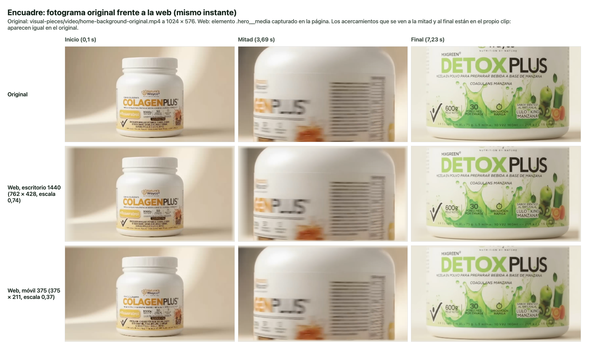
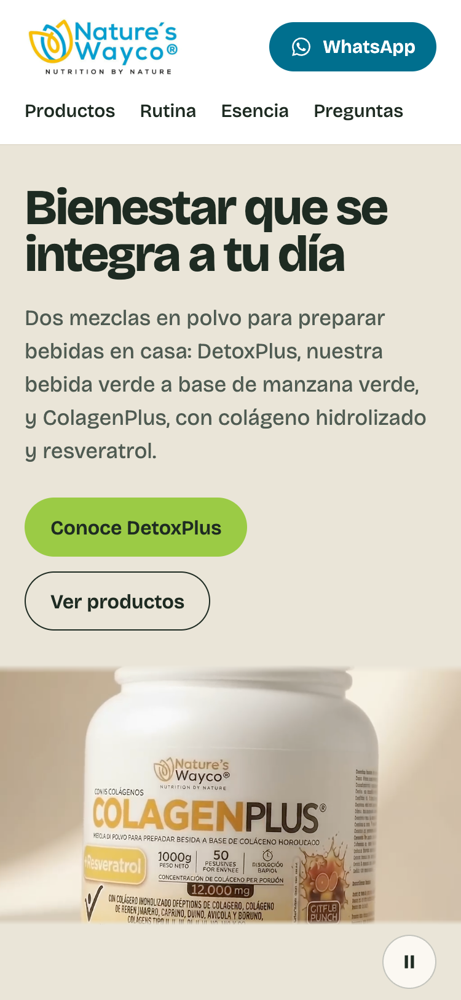
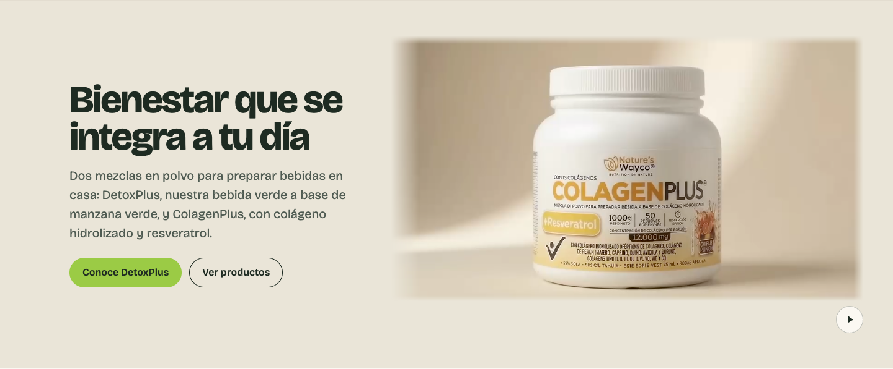
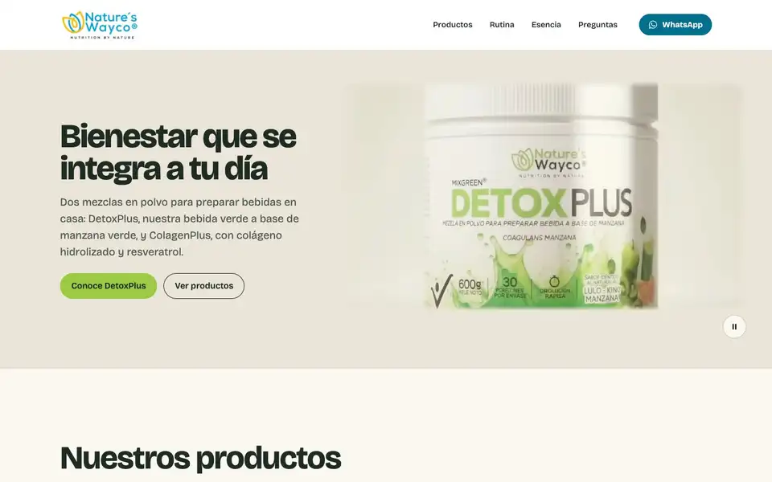

# Fase 3B · Encuadre y degradados del video de portada

Proyecto: landing de Nature’s Wayco · Fecha: 2026-10-21 · Estado: **corrección completa, no publicada**.

## Resumen

El video de portada se muestra ahora **completo**: fotograma 16:9 entero, sin recortes, sin ampliación por CSS y sin el velo claro que lavaba el producto.
- **Escritorio:** a la derecha del texto, con un tope de 1024 px, su ancho nativo.
- **Móvil y tableta:** debajo del texto, a todo el ancho de la pantalla.

Los bordes se funden en el fondo arena de la sección con máscaras estrechas. Su ancho se fijó tras medir el contenido de cada borde en todo el clip, para no tapar el envase ni su etiqueta.

**Verificación:** 122/122 pruebas en Chrome, entre ellas la comparación de fotogramas web contra el original. Build, lint y pruebas unitarias en verde.

**Sin cambios:** textos, CTA, catálogo, reproducción (automática, silenciada, en bucle), control, póster, respaldo y movimiento reducido.

> Sigue vigente el pendiente de la Fase 3: el texto de las etiquetas del video no corresponde al empaque
> real (`docs/pendientes.md`). Esta corrección lo deja **más visible**, porque el fotograma ya no se recorta
> ni se cubre con el velo.

## 1. Qué causaba el recorte

En la Fase 3, el video llenaba con `object-fit: cover` una caja del tamaño de toda la portada, y encima tenía un velo marfil de opacidad 0,90–0,94:

| Ancho | Caja | Ajuste | Parte visible del fotograma |
| --- | --- | --- | --- |
| 375 | 375 × 671 | ×1,17 por alto | 31 % del ancho |
| 768 | 768 × 693 | ×1,20 por alto | 62 % del ancho |
| 1440 | 1440 × 672 | ×1,41 por ancho | 83 % del alto; además, el velo tapaba la mitad izquierda |

**Ahora:**
- La caja del video tiene `aspect-ratio: 16 / 9` y el video usa `object-fit: contain`. Como la caja tiene la misma proporción que el video, se ve el fotograma completo y sin franjas.
- Se eliminaron `object-fit: cover`, `object-position`, el velo y la caja a sangre de toda la portada.
- No hay `transform` ni dimensiones sobredimensionadas.

## 2. Encuadre por tamaño

| Ancho | Distribución | Video | Escala sobre el original |
| --- | --- | --- | --- |
| 375 | Texto y botones arriba; video debajo, a todo el ancho | 375 × 211 | 0,37 |
| 768 | Igual que móvil | 768 × 432 | 0,75 |
| 1440 | Texto a la izquierda, alineado con la página; video a la derecha, a 48 px del borde | 762 × 428 | 0,74 |
| 2560 | Igual que 1440; el video llega a su tope | 1024 × 576 | 1,00, tamaño nativo |

- **Escritorio:** una grilla de columnas «margen · texto · espacio · video (hasta 1024 px) · resto». El texto queda alineado con el resto de la página y el video nunca sale de la ventana; en el control x va de 630 a 1392 de 1440 y de 1216 a 2240 de 2560.
- **Altura:** la dan el contenido y el video, no una altura fija: 596 px a 1440 y 756 px a 2560.
- **Móvil (375 × 812):** la portada mide 710 px y el video termina a 751 px, dentro de la primera pantalla.
- **Desbordamiento:** no hay a 320, 375, 768, 1440 ni 2560.
- **Control de pausa:** ahora va **debajo del video, a la derecha**, para no tapar ninguna parte del envase.

## 3. Degradados

**Fondo arena.** La sección usa un fondo arena `#EAE5D8`, cercano al fondo claro del propio clip, que completa el espacio libre. El texto mantiene su contraste sobre él:
- titular: 11,7:1 (mínimo 3:1);
- texto: 5,7:1 (mínimo 4,5:1).

**Máscara en los bordes.** Los bordes del video se funden con `mask-image` (degradados lineales combinados con `mask-composite: intersect`). Así no se agrega ninguna capa encima y el centro conserva sus píxeles originales: mismo color, contraste y opacidad.

Antes de fijar cada ancho revisé franjas del 10–12 % de cada borde en 31 fotogramas (uno cada 0,25 s):

| Borde | Transición | Qué hay en ese borde a lo largo del clip | Resultado |
| --- | --- | --- | --- |
| Izquierdo (hacia el texto) | **6 %** | Fondo durante casi todo el clip. En el primer plano final de DetoxPlus entra el cuerpo blanco del tarro desde ~1,5 %; el primer elemento de etiqueta (la palomita) está a ~10 %. | La transición solo toca el cuerpo blanco, nunca la etiqueta. |
| Derecho | **2 %** | Ilustraciones de la etiqueta hasta ~94–97 % en el primer plano final. | Solo toca el contorno del tarro. |
| Superior | **3 %** | Tapa. «MIXGREEN» aparece a ~7–8 % en el primer plano final. | Solo toca la tapa. |
| Inferior | **2 %** | Fila «600g · 30 porciones» hasta ~97 % (5,5–6,25 s). | Solo toca la base. |

**Móvil y tableta.** El video ocupa el ancho de la pantalla, así que solo se funden el borde superior (3 %) y el inferior (2 %); los laterales coinciden con el borde de la pantalla.

**Bordes visibles.** El borde izquierdo del clip cambia de color: tostado `#B2A18A`–`#C6B59E` en el tramo de ColagenPlus y crema `#E5E1D2`–`#EAE7D9` en el de DetoxPlus. Por eso, en el primer tramo la transición izquierda se ve como un paso suave de tostado a arena. Disimularla del todo habría exigido un degradado más ancho, que en el primer plano final cubriría el envase; se priorizó mostrar el contenido completo.

## 4. Verificación

### Realizadas

| Prueba | Resultado |
| --- | --- |
| `npm run build` | Correcto. JS 238,7 kB (75,3 kB gzip), CSS 15,3 kB (4,2 kB gzip). |
| `npm run lint` | Sin advertencias (código 0). |
| `npm test` | 11/11. |
| `CAPTURAS=fase-03b npm run verify` | **122/122**, ahora también a **2560 px**. Detalle en `docs/reports/verify-fase-03b.txt`. |
| Lighthouse 12.8, móvil (local, 2 corridas) | 97 · 100 · 100 · 100. FCP 1,4 s, LCP 2,6 s (el elemento LCP es el póster), CLS 0. |
| Lighthouse 12.8, escritorio | 100 · 100 · 100 · 100. LCP 0,5 s, CLS 0. |

**Encuadre comparado con el original** (prueba nueva, a 375, 768, 1440 y 2560):
- **Método.** Se toma el fotograma del archivo original (`visual-pieces/video/home-background-original.mp4`, a 1024 × 576) y el de la web en el mismo instante: inicio (0,1 s), mitad (3,69 s) y final (7,23 s). Se comparan en su zona central, fuera de las transiciones de borde.
- **Normalización.** Ambos se reducen a 256 × 144 con el mismo desenfoque de 1 px. Sin ese paso, el error a 375 px salía de 0,036, por la diferencia entre el filtro de escalado de Chrome y el del canvas, no por el encuadre: el mapa de diferencias solo mostraba contornos, en la misma posición.
- **Controles.** Se mide también el error contra el original **ampliado un 10 %** y **desplazado un 2 %**. Así queda probado que un cambio de encuadre o de posición se detectaría.

| Ancho | RMSE frente al original (inicio / mitad / final) | Control: ampliado 10 % | Control: desplazado 2 % |
| --- | --- | --- | --- |
| 375 | 0,014 / 0,011 / 0,013 | 0,072 – 0,145 | 0,055 – 0,108 |
| 768 | 0,007 / 0,006 / 0,007 | 0,070 – 0,144 | 0,054 – 0,108 |
| 1440 | 0,007 / 0,006 / 0,007 | 0,071 – 0,144 | 0,054 – 0,108 |
| 2560 | 0,005 / 0,004 / 0,005 | 0,069 – 0,143 | 0,054 – 0,108 |

En todos los casos el error frente al original es entre 4 y 27 veces menor que el de los controles. **El encuadre web es el del archivo original.**

**Acercamientos del clip y de CSS.** La escala por CSS es 0,37–1,00, nunca mayor que 1, y la caja muestra el fotograma completo. Los acercamientos que se ven entre 2 y 3,5 s (ColagenPlus) y entre 6,5 y 7,4 s (DetoxPlus) **están en el propio clip**: aparecen igual en el original (ver `encuadre-comparacion.png`). El clip no se editó.

**Otras verificaciones de la portada:**
- **Estilos:** `contain`, sin `transform`, radio 0, `aria-hidden`, sin clics ni foco, y ninguna capa sobre el video salvo póster y video.
- **Clic:** uno en el centro del video llega al contenedor, no al video.
- **Reproducción:** automática, silenciada (0 bytes de audio) y en bucle, con el fundido de cierre sobre el póster.
- **Pausas:** se pausa fuera de pantalla y con la pestaña oculta; la pausa manual se respeta y congela el cuadro.
- **Carga y fallos:** texto inmediato con el video retrasado; póster si el video falla.
- **Movimiento reducido:** póster estático y reproducción solo con el botón.
- **CTA:** llevan a `#detoxplus` y `#productos`.

**Verificaciones actualizadas:** la de «video decorativo» exigía antes `cover` y ancho completo; ahora exige `contain`, sin transformaciones, 16:9, ≤ 1024 px y dentro de la ventana. El clic se prueba en el centro del video y no en la zona superior de la portada. Siguen pasando las fichas con sus PNG, WhatsApp, teclado, video de Rutina y botón flotante.

### Pendientes (no realizadas)

- **Dispositivos reales:** iPhone (Safari) y Android (Chrome).
- **`mask-image` en Safari y Firefox:** está declarado con prefijo `-webkit-` y sin prefijo; se probó solo en Chrome.
- **Lector de pantalla:** VoiceOver o NVDA.
- **Modo `forced-colors`.**
- **Cambio real de pestaña:** en la prueba automática se simuló con `document.hidden`.

## 5. Cambios y archivos

| Archivo | Cambio |
| --- | --- |
| `src/components/Hero.css` | Fondo arena de la sección; grilla de dos columnas en escritorio y apilada en móvil; caja 16:9 con `object-fit: contain` y tope de 1024 px; máscaras de borde 6/2/3/2 %; control debajo del video. Se eliminaron `cover`, `object-position` por tamaño, el velo y la caja a sangre de toda la portada. |
| `src/components/Hero.tsx` | El texto y el video son bloques hermanos dentro de la grilla. El texto ya no va dentro del componente del video. |
| `src/components/HeroVideo.tsx` | Devuelve solo el bloque visual: póster, video y control. Se quitó el velo y se ajustó `sizes` del póster a su nuevo tamaño. La lógica de reproducción no cambió. |
| `scripts/verify-ui.mjs` | Ancho 2560; comparación de encuadre contra el original con controles; geometría 16:9 dentro de la ventana; sin capas sobre el video; contraste también a 2560. |
| `docs/reports/FASE-03B-ENCUADRE.md`, `verify-fase-03b.txt`, `capturas/fase-03b/` | Este reporte, la salida completa y 52 capturas y grabaciones. |

No se modificaron el clip, el póster, los textos, los CTA, el catálogo ni el resto de la página.

## 6. Limitaciones

1. **Bloqueante para publicar** (de la Fase 3): el texto inventado de las etiquetas del video ahora se ve completo.
2. **Resolución.** El video es de 1024 × 576. En píxeles CSS nunca se amplía, pero en pantallas de alta densidad se ve suave: a 2× el navegador lo amplía al doble en píxeles físicos.
3. **Tamaño en móvil.** El video queda pequeño (375 × 211) porque es horizontal y no se fuerza a llenar un espacio vertical. El control y el margen inferior quedan 15 px por debajo del primer pantallazo a 812 px de alto.
4. **Borde izquierdo en el tramo de ColagenPlus.** Se nota como un paso suave de tostado a arena (sección 3).
5. **Bucle.** Sigue sin ser continuo (corte de escena suavizado con el fundido, como en la Fase 3).
6. **2560 px.** El video queda en su tamaño nativo y deja 320 px de fondo a la derecha. Es la consecuencia esperada de no ampliarlo.

## 7. Capturas y grabación

En `docs/reports/capturas/fase-03b/`.

**Comparación de encuadre** (original frente a web a 1440 y 375, al inicio, mitad y final): `encuadre-comparacion.png`

**Portada por tamaño:**

| Ancho | Captura | Inicio / mitad / final |
| --- | --- | --- |
| Móvil 375 | [movil-375-portada.png](capturas/fase-03b/movil-375-portada.png) | [inicio](capturas/fase-03b/movil-375-portada-inicio.png) · [mitad](capturas/fase-03b/movil-375-portada-mitad.png) · [final](capturas/fase-03b/movil-375-portada-final.png) |
| Tableta 768 | [tableta-768-portada.png](capturas/fase-03b/tableta-768-portada.png) | [inicio](capturas/fase-03b/tableta-768-portada-inicio.png) · [mitad](capturas/fase-03b/tableta-768-portada-mitad.png) · [final](capturas/fase-03b/tableta-768-portada-final.png) |
| Escritorio 1440 | [escritorio-1440-portada.png](capturas/fase-03b/escritorio-1440-portada.png) | [inicio](capturas/fase-03b/escritorio-1440-portada-inicio.png) · [mitad](capturas/fase-03b/escritorio-1440-portada-mitad.png) · [final](capturas/fase-03b/escritorio-1440-portada-final.png) |
| Escritorio 2560 | [escritorio-2560-portada.png](capturas/fase-03b/escritorio-2560-portada.png) | [inicio](capturas/fase-03b/escritorio-2560-portada-inicio.png) · [mitad](capturas/fase-03b/escritorio-2560-portada-mitad.png) · [final](capturas/fase-03b/escritorio-2560-portada-final.png) |

| Móvil 375 | Escritorio 1440 |
| --- | --- |
|  |  |

**Estados:** [cargando](capturas/fase-03b/movil-375-portada-cargando.png) · [video fallido](capturas/fase-03b/movil-375-portada-sin-video.png)

**Grabaciones** (WebP animado, ~6,5 s: final del clip, fundido del bucle, reinicio y pausa manual):
- [grabacion-movil-375.webp](capturas/fase-03b/grabacion-movil-375.webp) (539 KB)
- [grabacion-escritorio-1440.webp](capturas/fase-03b/grabacion-escritorio-1440.webp) (620 KB)

