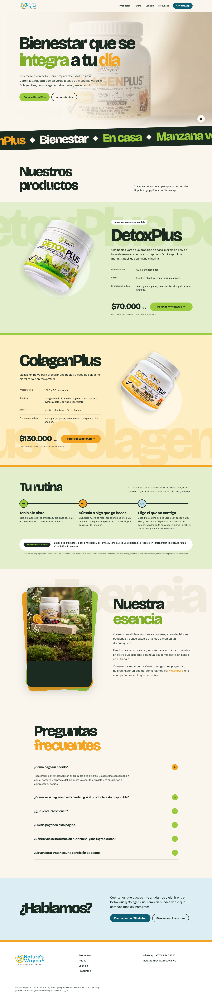

# Fase 4 · Implementación del diseño de Claude Design

Proyecto: landing de Nature’s Wayco · Fecha: 2026-10-21 · Estado: **implementado, no publicado**.

**Origen:** proyecto «Diseño dinámico Natures Wayco»: `Natures Wayco.dc.html` y sus recursos `img/logo.png`, `img/detox-jar.png`, `img/colagen-jar.png`, `img/esencia-bosque.png` y `video/hero-v2.mp4`.
- Lo leí con el conector de Claude Design, en solo lectura y sin modificar el proyecto.
- El conector entrega las imágenes truncadas a 256 KB, así que los binarios completos los tomé del paquete `Downloads/Diseño dinámico Natures Wayco-handoff.zip`. Verifiqué que su HTML y su `support.js` son idénticos a los de la API.

## 1. Resultado

La página reproduce el diseño sección por sección.

**Variantes:** el diseño trae cuatro variantes de barra y cuatro de rutina. Implementé las que el diseño tiene por defecto: barra «A · Actual», rutina «C · Línea del día» y movimiento «completo».

**Fidelidad, comparada con el prototipo renderizado en Chrome en las mismas condiciones:**

| Sección | Alto 1440 (diseño / app) | Diferencia de píxeles 1440 (RMSE) | Alto 375 (diseño / app) |
| --- | --- | --- | --- |
| Barra | 79 / 79 | 0,003 | 165 / 165 |
| Portada | 792 / 792 | 0,027 (cuadro del video) | 814 / 814 |
| Cinta | 167 / 167 | 0,002 | 95 / 95 |
| Nuestros productos | 368 / 368 | 0 | 389 / 389 |
| DetoxPlus | 902 / 902 | 0,018 / 0 | 1540 / 1540 |
| ColagenPlus | 895 / 895 | 0,010 / 0,001 | 1549 / 1549 |
| Tu rutina | 690 / 690 | 0 | 1431 / 1431 |
| Nuestra esencia | 918 / 918 | 0,010 / 0 | 1335 / 1335 |
| Preguntas | 1169 / 1169 | 0 / 0 | 1332 / 1332 |
| ¿Hablamos? | 438 / 438 | 0 | 683 / 683 |
| Pie | 385 / 385 | 0,004 | 634 / 634 |

Las diferencias que quedan son de remuestreo en los bordes de las imágenes (AVIF/WebP frente al PNG original) y del cuadro del video en el momento de la captura.

## 2. Qué se implementó

- **Barra fija** con fondo translúcido y desenfoque. El borde aparece al desplazarse. Logo con `multiply` y botón de WhatsApp con punto lima.
- **Portada:** video a sangre (`cover`, `scale(1.08)`), degradado horizontal e inferior, titular de dos líneas que sube, texto y CTA con entrada, y control ▶ / ❚❚.
- **Cinta** inclinada de palabras en movimiento continuo.
- **Productos:**
  - nombre gigante de fondo con paralaje horizontal;
  - disco blanco y envase con paralaje y giro;
  - especificaciones con entrada escalonada;
  - precio que rueda carácter a carácter;
  - botón «Pedir por WhatsApp →».
- **Tu rutina:** línea del día que se dibuja, tres pasos numerados y la píldora «Lo que indica la etiqueta».
- **Nuestra esencia:** tarjetas lima y ámbar giradas, foto con paralaje e inclinación 3D al pasar el puntero, y palabra de fondo.
- **Preguntas:** acordeón con la primera abierta, ícono + que gira a × y apertura animada.
- **¿Hablamos?** con el titular escalado al contenedor; **pie** con logo, secciones y contacto.

**Además del diseño, sin cambios visibles con ratón:**
- enlace «Saltar al contenido» y foco visible con teclado;
- `aria-expanded` y `aria-controls` en el acordeón;
- precios legibles por lectores de pantalla;
- video decorativo fuera del foco;
- pausa del video fuera de pantalla o con la pestaña oculta;
- con `prefers-reduced-motion` se usa el modo «apagado» del propio diseño: sin entradas, cinta, paralaje ni reproducción automática.

**Se conservan** los datos centralizados (catálogo, contacto), la acción de compra separada (`src/commerce/order.ts`) y la tipografía servida desde el proyecto. Es la misma Bricolage Grotesque que el diseño pide a Google Fonts, así que no hay solicitudes externas.

**Retirado** porque el diseño no lo tiene: botón flotante de WhatsApp, video de la sección Rutina, foto junto al lago, fondo arena y video sin recorte de la Fase 3B.

## 3. Archivos

| Tipo | Archivos |
| --- | --- |
| Originales copiados sin cambios | `visual-pieces/diseno/` (HTML del diseño, logo, 2 envases, imagen de Esencia); `visual-pieces/video/home-background-v2-original.mp4` (SHA-256 igual al del diseño) |
| Derivados web | `public/media/logo-diseno-*`, `detox-jar-*`, `colagen-jar-*`, `esencia-bosque-*` (AVIF/WebP + respaldo); `portada-video-poster-*`; `video/home-background.mp4` (copia sin audio, sin recodificar) |
| Componentes nuevos o reescritos | `Header`, `Hero`, `Ticker` (nuevo), `Products`, `Routine`, `Essence`, `Faq`, `Closing`, `Footer`, cada uno con su `.css`; `Picture`, `Logo`, `App`, `index.css` |
| Movimiento | `src/lib/useDesignMotion.ts` (nuevo): porta la lógica del script del diseño con los mismos valores |
| Datos | `src/data/media.ts` (solo recursos del diseño), `catalog.ts` (anclas `#detox` y `#colagen`), `contact.ts` (Instagram del diseño), `commerce/whatsapp.ts` y `order.ts` (mensajes del diseño) |
| Eliminados | `FloatingWhatsApp.*`, `HeroVideo.tsx`, `icons.tsx` (respaldo en la carpeta temporal de la sesión) |
| Scripts y pruebas | `build-media.mjs` (`--solo-diseno`), `verify-ui.mjs` (reescrito para la nueva página), `grabar-portada.mjs`, `tests/catalog.test.ts` |
| Documentación | este reporte, `verify-fase-04.txt`, `capturas/fase-04/` (51 archivos), `docs/pendientes.md`, `README.md` |

## 4. Verificación

| Prueba | Resultado |
| --- | --- |
| `npm run build` | Correcto. JS 240,8 kB (75,3 kB gzip), CSS 15,1 kB (4,0 kB gzip). |
| `npm run lint` | Sin advertencias. |
| `npm test` | 9/9: precios, orden, envases, URLs exactas de WhatsApp del diseño, derivados y video sin audio. |
| `CAPTURAS=fase-04 npm run verify` | **78/82.** Las 4 fallas son del diseño (abajo). |
| Lighthouse móvil (2 corridas) | 99 · 95 · 100 · 100. FCP 1,4 s, LCP 2,1 s, CLS 0, 1.585 KiB. |
| Lighthouse escritorio | 100 · 95 · 100 · 100. Accesibilidad: falla «frecuentes» en ámbar (1,92:1). |

**Pasa a 320, 375, 768, 1440 y 2560 px:**
- sin desbordamiento horizontal;
- imágenes con `alt`, dimensiones y carga correcta;
- todas las entradas terminan visibles, los precios ruedan y la línea se dibuja;
- sin errores de consola ni solicitudes externas.

**Pasan también:**
- 7 anclas válidas;
- enlaces de WhatsApp exactos al diseño, sin abrirlos ni enviar nada:
  - DetoxPlus: `…?text=Hola%2C%20quiero%20pedir%20DetoxPlus%20(%2470.000%20COP)`;
  - ColagenPlus: el equivalente;
  - los generales, sin mensaje;
- enlaces de Instagram;
- nombre, precio y envase de cada producto;
- **teclado:** salto al contenido, foco visible en todas las paradas, sin foco en el video, navegación con Enter y acordeón;
- **video:** reproducción automática silenciada (0 bytes de audio), bucle, pausa fuera de pantalla, con pestaña oculta y manual, CTA y fallo de carga;
- **movimiento reducido.**

**Fallas (del diseño, no de la implementación):** contraste del texto de portada a 375 y 768 px, al inicio y a la mitad del clip. El texto queda sobre la etiqueta del video porque el velo del diseño es horizontal. Medido igual en el prototipo y en la app: peor caso 1,29:1, mediana 7,67:1. A 1440 y 2560 pasa.

**Pendientes:** dispositivos reales (iPhone y Android), Safari y Firefox, lector de pantalla.

## 5. Puntos del diseño que necesitan decisión

Están detallados en `docs/pendientes.md`.

1. **Imágenes con texto inventado:**
   - la imagen de Esencia es generada («CIN & COLARNICS», «10000», «600%»);
   - los envases repiten «piña en polvo» y «con stevia»;
   - el video, «Coláceno horoucado».

   Siguen bloqueando la publicación.
2. **Contraste:** «día» y «frecuentes» en ámbar (1,93:1), «integra» y «esencia» en verde (2,44:1), «WhatsApp» en el texto de Esencia (1,93:1). Corrección sugerida: oscurecer esos tonos solo en texto (por ejemplo `#B36F00` y `#557A12`).
3. **Portada en móvil:** el texto sobre la etiqueta del video. Corrección sugerida: velo vertical en pantallas < 600 px.
4. **Recorte del video:** el diseño usa `cover` y `scale(1.08)`, lo contrario de lo pedido en la Fase 3B. Se siguió el diseño.
5. **Barra en móvil:** dos filas, 165 px de alto.
6. **Textos:** «Powered by MONTSERRAT_AI» en el pie; el mensaje de WhatsApp ya no pide confirmar disponibilidad ni envío.
7. **Derivados anteriores sin uso:** siguen en `public/media/` (53 archivos, 8,7 MB) y se publicarían con `dist/`. Se pueden quitar cuando se confirme el diseño.

## 6. Capturas y grabación

En `docs/reports/capturas/fase-04/`:
- **Página completa:** `escritorio-1440-pagina.png`, `movil-375-pagina.png`, también a 320, 768 y 2560.
- **Secciones:** `{tamaño}-detox.png`, `-colagen.png`, `-rutina.png`, `-esencia.png`.
- **Portada en tres momentos del clip:** `{tamaño}-portada-inicio|mitad|final.png`.
- **Estados:** `movil-375-movimiento-reducido.png` y `movil-375-portada-sin-video.png`.
- **Grabaciones:** `grabacion-movil-375.webp` y `grabacion-escritorio-1440.webp` (6,5 s, con pausa manual al final).

